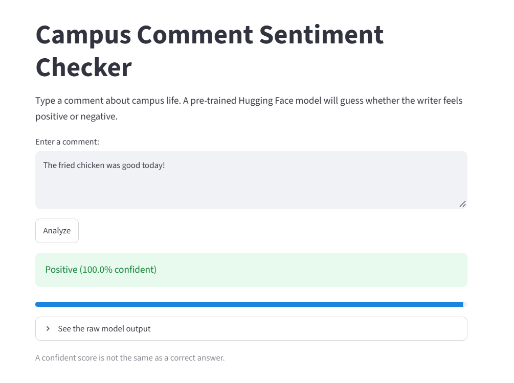

# Hugging Face Sentiment Analyzer

## Overview
This project demonstrates how to use Hugging Face Transformers to perform sentiment analysis on text. The application allows users to enter text and analyze its sentiment using a pretrained machine learning model.

## Technologies Used
- Python
- Hugging Face Transformers
- PyTorch
- Streamlit
- Jupyter Notebook
- Visual Studio Code

## Project Files
- **Demo Notebook:** `Hugging_Face_Demo.ipynb`
- **Application:** `app.py`.
- **Screenshot:** `sentiment.png`

## Running the Application Locally

1. Clone this repository:

   ```bash
   git clone https://github.com/YOUR_USERNAME/Hugging_Face.git
   cd Hugging_Face
   ```

2. Install the required libraries:

   ```bash
   pip install transformers torch streamlit
   ```

3. Run the application:

   ```bash
   streamlit run app.py
   ```

4. Open the local URL displayed in your terminal to use the application.

## Application Screenshot

The screenshot below shows the application running locally.



## Learning Objectives
- Explore pretrained models from Hugging Face.
- Use Transformers for natural language processing.
- Build and run a machine learning demo locally.
- Practice working with Jupyter Notebook, VS Code, and GitHub.
